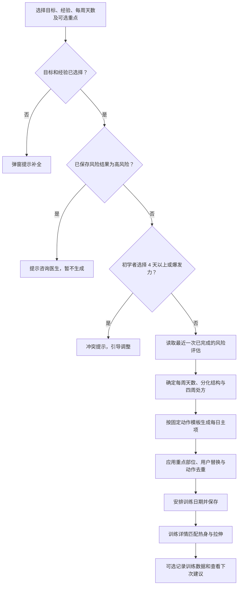

# FitMine 当前抗阻训练计划生成逻辑

> 整理日期：2026-10-29。本文依据当前工作区 `index.html` 的实现，描述产品实际行为，供产品、开发和测试核对；不是对 NSCA 教材逐条合规性的认证，也不是医疗建议。

## 1. 生成流程

当前产品生成四周抗阻计划，日期、用户替换动作和记录在生成后仍可调整。本文中的“高、中、低风险”指应用内问卷的分类，不能代替专业评估。

## 2. 输入和生成前判断

| 项目 | 当前选项或数据 | 作用 |
| --- | --- | --- |
| 训练目标 | 增肌、力量、爆发力、肌耐力 | 选择负荷、次数、休息、四周波动及动作模板。提交时必须选择。 |
| 训练经验 | 初学者：规律抗阻少于 6 个月；中级：6–12 个月；高级：超过 1 年 | 影响分化结构、基础组数和部分周期处方。提交时必须选择。 |
| 每周训练天数 | 2–6 天 | 影响分化、训练日数量和默认排程。 |
| 期望加强部位 | 胸、背、肩、手臂、臀、股四头肌、腘绳肌、小腿、核心；可不选 | 将匹配的复合动作提前，并在一个重点日尝试增加辅助动作。 |
| 加强目的 | 提升力量、增加肌肉、提高稳定性 | 决定重点辅助动作候选、组数、次数及休息。选了部位但目的无效时，按主目标推定：力量对应力量、增肌对应增肌，其余对应稳定性。 |
| 风险评估 | 最近一次已完成的问卷结果；没有结果时为“待评估” | 影响计划显示、每周天数及处方；问卷重新填写后必须完成评估才更新已保存结果。 |
| 年龄、生理性别、睡眠、压力、限制 | 用户资料与评估输入 | 年龄、生理性别及限制可参与风险判断；睡眠和压力可参与恢复评分，但当前 `buildPlan` 不直接依据它们改写训练天数或动作。 |

初学者选择每周 **4 天及以上**或选择**爆发力**时会显示冲突弹窗，保存时再次检查。两个冲突同时存在时，先提示训练天数；改为 3 天后仍需处理爆发力冲突。系统不会在保存新计划时静默把 4 天改成 3 天。旧计划有版本兼容逻辑，不代表旧计划会被自动转换成新规则。

编辑已有计划时，若目标、经验、天数、加强部位及目的均未变化，且当前周期未结束，提示“已有相同计划”，不新建周期。

## 3. 风险结果如何影响计划

`getPlanRisk` 读取已保存评估结果；未完成评估时显示待评估，并建议先完成评估。问卷中胸痛、晕厥或异常呼吸困难、医生提示心脏病/高血压或需许可、相关慢性疾病、近期手术或医疗限制等被代码视为高风险信号。风险因素达到一定数量，或存在药物、损伤、动作限制时，可归为中风险。

| 结果 | 代码中的实际处理 |
| --- | --- |
| 待评估 / 低风险 | 按目标和经验构建常规计划。 |
| 中风险 | 分化说明增加前 2–4 周降低总组数、保留 3 次以上余力的提示；当前未通过此分支实际扣减处方组数或重新选择动作。 |
| 高风险 | 自主生成、官方模板和历史模板生成时弹窗建议咨询医生，获医学许可后按医生建议进行低强度活动，暂不生成新计划。点击“确定”关闭弹窗。判断依据是最近一次已保存的风险评估结果。 |

**实现边界：**这是对新计划生成的拦截，不自动核实医学许可，也不改变已有计划。底层仍存在高风险后备计划及原目标四周波动的兼容代码，不应作为个体化医疗运动处方。

## 4. 目标处方和四周周期

### 4.1 顶层建议

| 目标 | 建议负荷 | 次数 | 基础组数 | 休息 |
| --- | --- | --- | --- | --- |
| 增肌 | 67–85% 1RM，约 6–12 RM | 6–12 次 | 初学 3，中级 4，高级 5；显示范围 3–6 组 | 30–90 秒 |
| 力量 | ≥85% 1RM；初学显示 5–6 RM，其余 ≤6 RM | ≤6 次 | 初学 3，其余 4；显示范围 2–6 组 | 2–5 分钟 |
| 爆发力 | 75–90% 1RM，1–5 RM | 1–5 次 | 非初学 4；显示范围 3–5 组 | 2–5 分钟 |
| 肌耐力 | ≤67% 1RM，≥12 RM | ≥12 次 | 初学 2，其余 3；显示范围 2–3 组 | ≤30 秒 |

### 4.2 每周主项波动

表中为每周“负荷 / 次数”；实际动作会继承当周次数及组间休息。初学者新计划不能选择爆发力。

| 目标 | 第 1 周：动作适应 | 第 2 周：容量递进 | 第 3 周：目标强化 | 第 4 周：减载巩固 |
| --- | --- | --- | --- | --- |
| 增肌 | 70% / 8–12 次 | 75–77% / 8–10 次 | 80–82.5% / 6–8 次 | 65–70% / 10–12 次 |
| 力量 | 85% / 5–6 次 | 87.5% / 3–5 次 | 90–93% / 1–3 次 | 65–70% / 6–8 次 |
| 爆发力 | 75% / 3–5 次 | 80% / 2–4 次 | 85–90% / 1–3 次 | 55–65% / 3–5 次 |
| 肌耐力 | 55–60% / 15–20 次 | 60–63% / 13–18 次 | 65–67% / 12–15 次 | 50–55% / 15–20 次 |

组数计算：第 1、4 周为 `max(2, 基础组数 − 1)`；第 2 周为基础组数；第 3 周高级用户为基础组数加 1，其他用户为基础组数。常规模板中最后一个辅助动作的组数为 `max(2, 当周主项组数 − 1)`，休息 45–60 秒；增肌目标的该辅助动作使用 10–15 次。

**实现边界：**第 4 周文案写“减少约 40%–50% 训练组数”，但实际公式只是基础组数减 1 且至少 2 组，并不保证达到该比例。四周百分比是预设建议，并非依据个人实测 1RM 自动计算的工作重量。

## 5. 每周结构和日期

常规新计划天数由用户选择及风险结果决定，范围 2–6 天。分化由目标、经验、天数共同选择：

- 初学者允许的新计划为每周 2–3 天全身训练；代码保留旧版初学者 4 天的兼容路径。
- 中级用户 2–3 天采用全身、4 天采用上下肢、5–6 天采用推拉腿及补充日。
- 高级用户 2 天采用全身、3 天采用推拉腿、4 天采用上下肢、5–6 天采用推拉腿及补充日。

默认星期安排：2 天为周一/周四；3 天为周一/周三/周五；4 天为周一/周二/周四/周五；5 天为周一/周二/周三/周五/周六；6 天为周一至周六。计划开始日期用于定位每个七日周期内的首个训练日期；用户可修改当前周或整个计划的训练日。

初学者且每周不超过 3 天时，保存训练日选择要求相邻训练日期至少间隔一天，包括跨周；排程顺延时也按至少相隔两个日历日处理。其他计划的相邻训练日按至少相隔一个日历日处理。**这是按日期执行的规则，不是逐个肌群实际恢复小时数的计算。**

单次“推迟到明天”和“跳过本次”只允许对当日未完成计划操作；冲突时，后续训练按顺序向后顺延并遵守上述日期间隔。跳过的训练不占用后续冲突间隔。暂停记录暂停日期，恢复后按暂停天数平移受影响日期。周期结束日期取调整后所有计划日中最晚日期；未暂停且今天晚于结束日期时显示已结束。

## 6. 动作、重点部位和准备活动

### 6.1 动作生成

计划使用代码内的固定日模板，不是根据动作库全部标签进行自由搜索。增肌与其他目标分别选择模板，按经验及天数切换全身、上下肢或推拉腿结构；部分指定模板可覆盖默认结构。动作通常含名称、重点、动作提示、组次与休息。

选择重点部位后，系统通过动作名称及重点文字匹配，尽量将第一个匹配的重点复合动作移到当天开头；计算哪一天匹配程度最高，在该日从动作库候选中追加一个尚未使用的重点辅助动作。普通周：增肌目的为 3 组，高级为 4 组；力量和稳定性为 2 组。减载周统一为 2 组。若候选动作不存在或已使用，则不追加。

生成后应用用户的动作替换，再按动作 ID 或名称去重；重复时从同类别动作中按主要肌群、复合/孤立、推拉属性评分选择替代；没有候选时移除重复项。因此，保留动作模式是设计方向，当前不是对所有肌群、模式或每周有效组数的严格约束验证。

### 6.2 热身与拉伸

详情页根据主项名称和重点中的关键词计数，将训练识别为上肢推、上肢拉、上肢混合、后链、膝主导或全身；各类型对应两项动态准备动作和一项静态拉伸。例如膝主导使用踝环绕、世界最佳拉伸；后链使用站姿髋环绕、毛毛虫。无法判断时按计划描述兜底，再无法判断则使用全身准备。

## 7. 模板、保存与历史

- 公开的官方计划模板目前展示增肌每周 3 天和 4 天；3 天适用于初学及以上，4 天要求中级及以上。
- 第一次使用官方模板且未保存选项时，引导先填写生成选项；已有选项时检查经验是否达到模板最低要求。确认使用时，模板目标与天数覆盖当前选择。
- 若使用官方模板会替换未结束的当前计划，会提示替换，原计划归档到历史。
- 历史模板根据保存的计划设置去重；使用历史模板重新创建周期，并应用当前冲突判断。
- 保存新计划写入目标、经验、天数、重点设置、风险问卷、模板标识和开始日期。替换时归档旧计划并清理旧排程调整；旧的训练记录仍由记录功能保存。

## 8. 起始重量与渐进建议

计划详情中，当未完成的训练日包含没有当前记录、也没有历史记录的动作时，可出现三种起始重量选项：使用已知重量、通过试做组确定、暂时跳过。已完成训练日不会展示该引导；已有训练数据的动作不再作为新动作提示。

试做反馈为轻松时，建议上肢约增加 5%、下肢约增加 7.5% 后再试；过重或未完成建议降低约 5%；合适时可确认工作重量；疼痛或动作失控时提示停止。建议重量按 0.5 kg 取整。试做组不计入正式训练量。

正式记录按计划组数展示每组重量与次数：优先使用当前已保存数据，再使用上一条对应动作记录的重量，次数默认目标次数；用户可应用首组到其他组并标记完成。保存后基于已完成组及最后一组难度生成文字建议：

1. 无有效组：数据不足；疼痛：停止或更换动作。
2. 未完成计划组数：保持重量；完成全部组但未达次数下限：建议降低约 5%。
3. 最后一组很吃力：保持重量。
4. 每组达到次数上限且难度为轻松或合适：建议下次按最小可用档位加重，上肢通常 2.5%–5%，下肢通常 5%–10%。
5. 未全部达到上限但感觉轻松：优先每组增加 1 次；其他情况保持。

**实现边界：**计划页面另有“2-for-2”说明，但上述自动建议使用本次各组次数与主观难度，并未验证连续两次训练是否都超出目标 2 次；推荐是文字建议，不代表已自动将建议后的重量写入下一次训练。

## 9. 需要优先复核的差异

1. 已保存的高风险评估阻止新计划生成；既有计划、高风险历史兼容数据和重新评估后的使用方式仍需要单独设计。
2. 中风险“降低组数”的文字与实际组数计算不一致。
3. 第 4 周“减少 40%–50%”与实际组数公式不一致。
4. 自动渐进建议与页面的 2-for-2 文字属于不同判定，需统一产品定义。
5. 当前重点匹配、去重和训练日间隔是规则及关键词驱动，未对所有用户的肌群恢复、动作模式覆盖或训练量进行完整约束校验。
6. 计划中的百分比与 RM 范围是固定映射；尚未基于用户能力、器械和动作特点逐项验证是否匹配。

## 10. 主要代码位置

- 输入与冲突：`getProfile`、`getPlanSelectionConflict`、`showPlanNotice`。
- 风险与周期：`assessRisk`、`getPlanRisk`、`getGoalPrescription`、`createPeriodization`、`buildPlan`。
- 训练分化与排程：`makeSplit`、`makeHypertrophySplit`、`getResolvedPlanSchedule`、`changePlanSchedule`。
- 动作与准备：`getWorkoutExercises`、`applyFocusEmphasis`、`ensureUniqueWorkoutExercises`、`getTargetedPreparation`。
- 重量与渐进：`buildCalibrationRecommendation`、`getWorkoutSetEntries`、`buildProgressionRecommendation`。
- 对应测试主要位于 `tests/plan-periodization.test.mjs` 与 `tests/plan-adaptation.test.mjs`。
