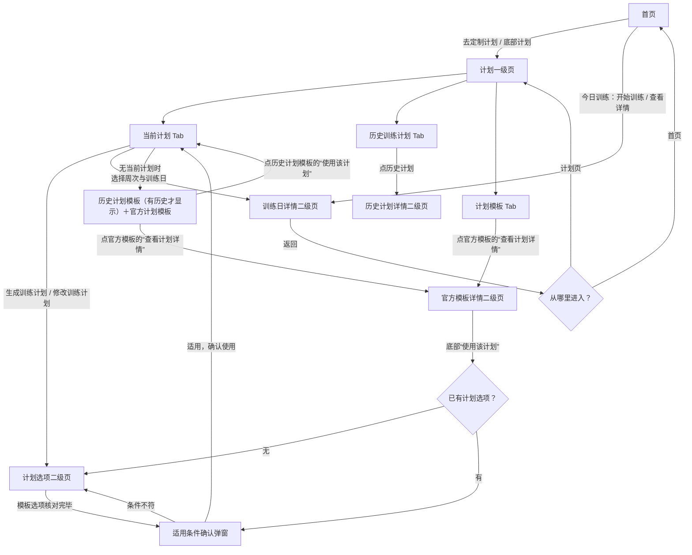
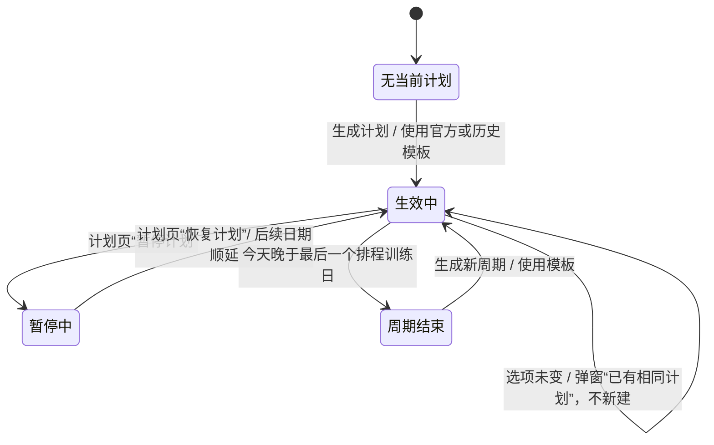
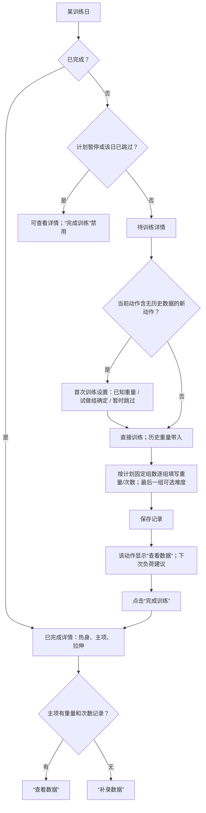

# FitMine 计划状态流程原型（中文版）

基于当前 `index.html` 整理，供产品流程评审。这里描述的是**当前实现**；文末单列需要确认的交互。计划状态与训练日状态分开判断，避免把“已完成训练”误当作“已记录重量和次数”。

## 1. 页面结构

说明：无当前计划时，官方模板同时出现在“当前计划”页下方和独立的“计划模板”Tab；独立 Tab 在有当前计划时仍可查看。模板详情展示四周安排和主项动作预览，底部才有“使用该计划”。

## 2. 整个计划的生命周期

“周期结束”是界面计算状态：旧计划资料仍保存在本地，计划页的当前 Tab 按“当前无计划”展示，旧周期可从历史 Tab 查看；替换计划会把旧计划写入历史列表。

## 3. 状态展示矩阵

| 状态与判定 | 首页“今日计划” | 计划页“当前计划”Tab | 主要去向 |
|---|---|---|---|
| 首次使用：无当前计划、无历史 | “当前无计划”＋“去定制计划” | “当前无计划”＋“生成训练计划”；下方只显示“官方训练计划模板” | 填选项生成，或先看官方模板详情 |
| 无当前计划、有历史 | 同上，并以小字显示上一个计划名称和结束日期 | 生成入口；下方显示去重后的历史计划模板及官方模板 | 历史模板可直接使用；官方模板先看详情 |
| 有效计划、今天无排程 | “休息日”、恢复说明和下个训练日 | 计划指标、四周周次、训练日、负荷规则；可暂停或修改计划 | 选择未来训练日可看详情；首页可调整训练日 |
| 有效计划、今天有待训练排程 | 训练日名称、主项概要；“开始训练”，弱化的“推迟到明天”“跳过本次” | 同上；当天训练日可进入详情 | 开始训练进入训练日详情 |
| 当日训练已推迟 | 显示“已推迟到明天 / 训练已推迟”和实际训练日期 | 对应训练日日期更新 | 到新排程日期再训练 |
| 当日训练已跳过 | “今日训练已跳过”＋“撤销跳过” | 对应训练日标“已跳过” | 当天可撤销跳过 |
| 计划暂停中 | 显示“计划已暂停”、顺延说明和“恢复计划” | 保留当前计划内容；周课表内按钮变“恢复计划”，文字提示暂停期间不安排训练 | 恢复后按暂停天数顺延 |
| 当日训练已完成 | “已完成”＋“查看详情”；不再展示推迟/跳过 | 当前计划继续显示该训练日 | 详情页查看动作及数据；记录页日历标识已完成 |
| 周期结束 | “当前无计划”＋上个计划名称/结束日期＋“去定制计划” | “当前无计划”＋模板入口；当前指标与周课表隐藏 | 历史 Tab 查看旧周期；可生成新计划 |

历史 Tab 始终保留。无历史时显示“当前无历史计划记录”；有历史时显示开始/结束日期、完成数与完成率。点卡片进入二级详情，按周列出每个训练日的日期、动作及“已完成 / 已跳过 / 未完成”。

## 4. 单个训练日的流程

完成训练会写入已完成状态和训练日历，即使没有填写具体重量与次数；未录入的主项在已完成详情里提示补录。记录数据和完成训练是两个独立动作。

## 5. 计划入口与分支细则

| 操作 | 当前流程 |
|---|---|
| 自主生成 | “生成训练计划” → 二级选项页（目标、经验、天数、可选重点部位与目的）→ 生成四周计划 → 当前计划 Tab。 |
| 修改有效计划 | “修改训练计划” → 二级选项页；选项不变时弹“已有相同计划”，确认后返回计划页且不重建；选项改变时旧计划归档、新周期开始。 |
| 查看官方模板 | 当前页或模板 Tab → “查看计划详情” → 二级详情（指标、四周、每日主项、负荷规则）→ 返回原 Tab；预览本身不保存计划。 |
| 使用官方模板 | 模板详情底部 → 从未填写计划选项时先填写；已有选项时直接确认，所需训练天数随模板更新；仅初学者选择要求中级及以上的模板时引导调整经验。若有有效计划，弹窗提示“当前计划会被替换” → 点击“确定”创建新计划；高风险评估会禁用使用入口。 |
| 使用历史计划模板 | 无当前计划时，在当前 Tab 的历史模板卡片点击“使用该计划” → 直接以保存的选项创建新周期并返回当前计划。 |
| 查看历史计划 | 历史 Tab → 历史计划详情二级页 → 返回历史 Tab；详情提供每个训练日完成状态。 |
| 当天调整排程 | 首页仅在“今天有未完成训练”时显示推迟/跳过；推迟后日期顺延，跳过后可在当天撤销；未来训练日没有这些按钮。 |
| 暂停/恢复 | 当前计划的周课表内保留原有“暂停计划 / 恢复计划”入口；暂停期间首页也可“恢复计划”，后续排程不显示，恢复后顺延。 |

## 6. 待确认的产品流程点

以下是代码与界面流程的观察，**不是已实施的改动**：

1. **推迟后的撤销入口**：首页现会显示推迟结果与新训练日期，暂未提供“撤销推迟”。
2. **训练日完成与数据完整性**：完成训练允许零重量/次数记录，符合当前设计；应继续明确区分“已完成”与“已记录数据”，避免后续统计误读。

本轮已确认：暂停入口保留在原周课表位置，首页显示暂停状态；官方模板替换当前计划前需弹窗提示；历史模板保持直接使用，无须适用性确认。
